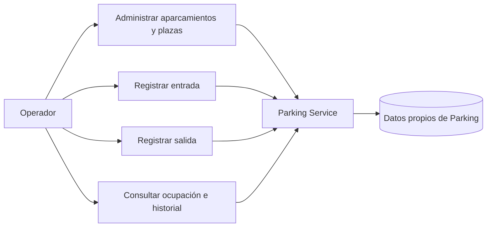
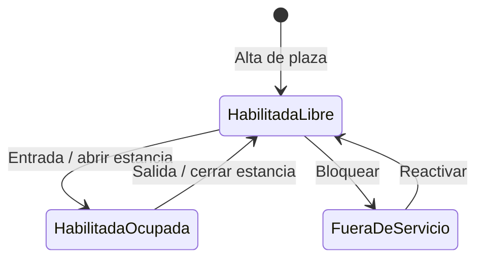
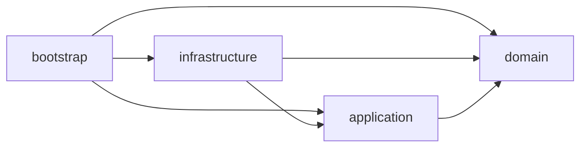

# Parking Service — Alcance y casos de uso iniciales

**Estado:** propuesta de trabajo pendiente de revisión por Julio y el tutor.  
**Autoría:** borrador elaborado con asistencia de IA a petición de Julio; no representa requisitos ya aprobados ni funcionalidades implementadas.  
**Microservicio:** `parking-service`. **Versión del documento:** 0.1.

## 1. Propósito y límites

Parking Service gestiona aparcamientos, sus plazas y las estancias de vehículos. Permite a un operador registrar entradas y salidas y consultar la ocupación y el historial, manteniendo coherentes los datos aunque haya solicitudes simultáneas.

Este documento reúne todos los casos de uso propuestos para la primera versión. El número responde al alcance funcional, no a una cuota. Un caso de uso no equivale necesariamente a un único endpoint ni a una clase por cada paso.

**Actor principal:** operador del aparcamiento. En el MVP, un único perfil funcional puede realizar todas las operaciones descritas. No se implementará aquí una administración de usuarios. La identificación y autorización deberán resolverse antes de exponer el servicio fuera de un entorno de demostración controlado; no se presupone un proveedor concreto.

**Incluido:** administración básica de aparcamientos y plazas, bloqueo por mantenimiento, entradas, salidas, ocupación actual, consulta de estancias y estadísticas básicas.

**Excluido:** reservas futuras, cobros, tarifas, facturas, sensores, barreras físicas, reconocimiento de matrículas, aplicaciones móviles, eliminación de históricos, corrección manual de estancias, gestión de usuarios y coordinación con un segundo microservicio todavía no definido. No se añaden horarios: los aparcamientos se consideran operativos las 24 horas.

## 2. Decisiones propuestas y reglas comunes

Estas decisiones son explícitas para que puedan revisarse antes de implementar los casos afectados.

| ID | Decisión inicial |
| --- | --- |
| R01 | Un aparcamiento tiene ID estable generado por el sistema, nombre y ubicación textual obligatorios; descripción opcional. No hay búsqueda geográfica ni obligación de nombres únicos. |
| R02 | La capacidad se deriva del número de plazas registradas. No se mantiene otro campo de capacidad editable. Un aparcamiento recién creado tiene capacidad cero. |
| R03 | Una plaza pertenece a un solo aparcamiento y tiene ID estable y código visible único dentro de ese aparcamiento. Su código se recorta y convierte a mayúsculas para comparar. No puede cambiarse de aparcamiento. |
| R04 | El estado operativo de la plaza es HABILITADA o FUERA_DE_SERVICIO. Su ocupación se deriva de la existencia de una estancia abierta. Libre significa habilitada y sin estancia abierta. |
| R05 | El operador elige la plaza concreta al registrar una entrada. Todas las plazas admiten los mismos vehículos en el MVP; no hay categorías ni asignación automática. |
| R06 | Una estancia pertenece a una plaza y contiene ID, matrícula normalizada, instante de entrada y salida opcional. Está ABIERTA sin salida y CERRADA con salida. No hay catálogo independiente de vehículos. |
| R07 | La matrícula se recorta, convierte a mayúsculas y se eliminan espacios y guiones; se admiten entre 1 y 15 caracteres alfanuméricos ASCII tras normalizar. Es una simplificación de identificación para la demo, no una validación legal internacional. Una matrícula no puede tener dos estancias abiertas en ningún aparcamiento gestionado por el servicio. |
| R08 | Los instantes los genera el servidor en UTC. No se admiten entradas o salidas retroactivas. La salida no puede ser anterior a la entrada. Los filtros temporales usan intervalos [desde, hasta), con inicio incluido y final excluido. |
| R09 | No se puede bloquear ni cambiar el código de una plaza ocupada. Bloquear una plaza ya bloqueada o habilitar una ya habilitada conserva el estado sin error. El bloqueo requiere motivo no vacío. La reactivación elimina el motivo vigente; una auditoría de cambios queda fuera del MVP. |
| R10 | Registrar salida exige el ID de estancia. Repetir la salida devuelve la estancia ya cerrada, conserva su primer instante de salida y no vuelve a liberar capacidad. |
| R11 | Una entrada válida crea la estancia de forma atómica. Nunca puede haber dos estancias abiertas para una plaza ni para una matrícula. Comprobar disponibilidad y escribir sin protección ante concurrencia no satisface esta regla. |
| R12 | No se borran aparcamientos, plazas ni estancias en el MVP. Así se preservan referencias e historial. Los detalles históricos usan los IDs estables y los nombres/códigos actuales; no se prometen instantáneas de nombres anteriores. |
| R13 | Las listas se paginan: página desde 0, tamaño por defecto 20 y máximo 100. Orden estable: ID ascendente en aparcamientos y plazas; entrada descendente e ID como desempate en estancias. Filtros mal formados se rechazan; una búsqueda válida sin coincidencias devuelve lista vacía. |
| R14 | La matrícula y el historial no se incluyen en consultas agregadas de ocupación. Los logs técnicos no deben volcar matrículas ni cuerpos completos de solicitudes. |

Los límites de longitud de nombre, ubicación, descripción, código y motivo deben fijarse al preparar sus contratos, antes de implementar los casos afectados. No quedan delegados accidentalmente a las longitudes de columnas de la base de datos.

### Ocupación y capacidad

- **Total:** todas las plazas registradas.
- **Fuera de servicio:** plazas bloqueadas.
- **Operativas:** total menos fuera de servicio.
- **Ocupadas:** plazas con estancia abierta.
- **Libres:** operativas menos ocupadas.
- Invariante: `total = fueraDeServicio + ocupadas + libres`.
- Porcentaje de ocupación: `ocupadas / operativas × 100`; si no hay plazas operativas, se devuelve `null`, no un error ni un porcentaje engañoso.

### Esquema funcional

El segundo esquema combina estado operativo y ocupación para explicar el comportamiento; no obliga a almacenar un único enum con esos tres valores.

## 3. Arquitectura hexagonal y forma de trabajo

Se conserva la estructura modular existente. Las flechas siguientes representan dependencias de código, no llamadas HTTP:

| Módulo | Responsabilidad al desarrollar estos casos |
| --- | --- |
| `domain` | Modelo e invariantes: plaza, estancia, matrícula y transiciones. Sin Spring, HTTP ni JPA. Las invariantes globales necesitan además garantías de persistencia; no basta una comprobación en un objeto. |
| `application` | Puertos de entrada y coordinación de casos de uso; puertos de salida para persistencia, reloj u otras necesidades externas. Depende de dominio, sin Spring ni entidades JPA. |
| `infrastructure` | Adaptadores HTTP y persistencia; DTO, validación de formato, mapeos, traducción de errores y mecanismos transaccionales/concurrencia. Implementa los puertos de salida. |
| `bootstrap` | Arranque Spring Boot y composición de implementaciones. No contiene reglas de negocio. |

La ubicación de los puertos de salida en `application` es una convención propuesta para este proyecto. No se crean interfaces sin una frontera útil ni se comparten entidades JPA con el dominio. El límite transaccional de cada operación de escritura debe estar documentado y resuelto mediante composición/adaptadores, manteniendo el núcleo independiente del framework.

Los errores funcionales se expresan sin códigos HTTP en el núcleo. El adaptador web los traduce de forma consistente: entrada mal formada (400), recurso inexistente (404) y conflicto de estado o unicidad (409). Los detalles del contrato HTTP se acuerdan en la DoR; no se exponen excepciones internas ni SQL al cliente.

**Flujo Git:** rama `feature/...` desde `develop` → PR y validación hacia `develop` → integración de una entrega verificada en `main` y etiqueta. Las pruebas se ejecutan también en las features/PR antes de integrar; `develop` es la rama de integración y validación conjunta. `main` se reserva para entregas, no para desarrollo cotidiano. No se hacen push directos a `main` como sustituto de revisar la entrega. Docs mantiene historial independiente de Parking Service. Los cambios coordinados enlazan sus respectivas PR.

## 4. Definition of Ready y Definition of Done comunes

Las listas comunes forman parte de **cada** caso de uso y se completan junto con sus comprobaciones específicas. Están sin marcar porque este documento no constituye una aprobación ni una implementación.

### DoR común

- [ ] Actor, objetivo, alcance y reglas aplicables revisados por Julio; dudas de alcance contrastadas con el tutor cuando corresponda.
- [ ] Entradas, límites, resultado y errores definidos, incluyendo contrato HTTP y permisos cuando aplique.
- [ ] Criterios de aceptación entendidos y comprobables; datos de ejemplo preparados.
- [ ] Dependencias funcionales y puertos necesarios identificados, sin acoplar el núcleo a Spring o a una base de datos.
- [ ] Issue del caso creada y enlazada; estrategia de pruebas y tratamiento de concurrencia acordados cuando aplique.

### DoD común

- [ ] Criterios de aceptación y reglas del caso satisfechos, incluidos errores y ausencia de cambios parciales.
- [ ] Reglas en `domain`, coordinación en `application`, adaptadores en `infrastructure` y composición en `bootstrap`, respetando la dirección de dependencias.
- [ ] Pruebas de dominio/aplicación y de los adaptadores relevantes pasan; se cubren los riesgos del caso sin duplicar mecánicamente pruebas por capa.
- [ ] Compilación y comprobaciones acordadas pasan con Gradle Wrapper. Migraciones verificadas si cambia el esquema; pruebas con base de datos real para restricciones y transacciones relevantes.
- [ ] Contrato de API, errores y documentación actualizados; sin exposición innecesaria de matrículas en logs.
- [ ] Código revisado e integrado mediante PR hacia `develop`; issue, PR y evidencias de validación enlazadas. Si cambia el contrato documentado, se enlaza también la PR de Docs.

Publicar en `main` no es condición para terminar cada caso: corresponde a una entrega verificada que puede agrupar varios casos.

## 5. Catálogo

| ID | Caso de uso | Dependencias funcionales |
| --- | --- | --- |
| CU-PAR-01 | Registrar aparcamiento | Ninguna |
| CU-PAR-02 | Modificar datos del aparcamiento | 01 |
| CU-PAR-03 | Listar y buscar aparcamientos | 01 |
| CU-PAR-04 | Consultar detalle de aparcamiento | 01 |
| CU-PAR-05 | Registrar plaza | 01 |
| CU-PAR-06 | Modificar código de plaza | 05 |
| CU-PAR-07 | Bloquear plaza | 05 |
| CU-PAR-08 | Reactivar plaza | 07 |
| CU-PAR-09 | Consultar plazas | 05 |
| CU-PAR-10 | Consultar ocupación actual | 05; 11 y 12 para comprobar cambios |
| CU-PAR-11 | Registrar entrada | 01, 05 |
| CU-PAR-12 | Registrar salida | 11 |
| CU-PAR-13 | Consultar vehículos presentes | 11, 12 |
| CU-PAR-14 | Consultar historial de estancias | 11, 12 |
| CU-PAR-15 | Consultar detalle de estancia | 11 |
| CU-PAR-16 | Consultar estadísticas básicas | 11, 12 |

Las dependencias señalan datos o comportamiento necesarios, no obligan a llamar a un caso desde otro ni impiden preparar pruebas con fixtures.

## 6. Casos de uso

### CU-PAR-01 — Registrar aparcamiento

**Caso de uso:** el operador registra un aparcamiento para comenzar a administrar sus plazas.

- **Entrada:** nombre, ubicación textual y descripción opcional.
- **Precondición:** ninguna de negocio.
- **Flujo:** validar datos, generar ID y guardar el aparcamiento sin plazas.
- **Resultado:** aparcamiento consultable con capacidad cero. Reglas R01 y R02.
- **Alternativas:** datos inválidos se rechazan sin crear registros. Nombres repetidos se admiten.

**Criterios de aceptación**
- [ ] Dados datos válidos, al registrar se obtiene un ID y los datos persistidos.
- [ ] Un aparcamiento nuevo tiene cero plazas y ninguna estancia.
- [ ] Un nombre o ubicación vacíos se rechazan sin persistencia parcial.

**DoR:** DoR común y límites de los campos acordados.  
**DoD:** DoD común y creación/recuperación verificadas mediante el adaptador de persistencia.

### CU-PAR-02 — Modificar datos del aparcamiento

**Caso de uso:** el operador actualiza los datos descriptivos de un aparcamiento.

- **Entrada:** ID y nuevo nombre, ubicación y descripción; se propone sustitución completa de esos campos.
- **Precondición:** aparcamiento existente.
- **Flujo:** recuperar, validar y guardar los datos nuevos, conservando ID y relaciones.
- **Resultado:** datos descriptivos actualizados. Reglas R01, R02 y R12.
- **Alternativas:** ID inexistente o datos inválidos; no se permite editar capacidad. Para ediciones simultáneas válidas se acepta la última escritura confirmada, sin mezclar campos de ambas solicitudes.

**Criterios de aceptación**
- [ ] Una modificación válida no altera plazas, estancias ni identificadores.
- [ ] Una modificación inválida conserva todos los datos anteriores.
- [ ] Un ID inexistente produce un error de recurso no encontrado.

**DoR:** DoR común y campos editables/límites confirmados.  
**DoD:** DoD común y pruebas que acrediten la conservación de relaciones y la actualización atómica de los campos.

### CU-PAR-03 — Listar y buscar aparcamientos

**Caso de uso:** el operador localiza aparcamientos por su nombre.

- **Entrada:** texto opcional de búsqueda, página y tamaño.
- **Flujo:** buscar por subcadena del nombre sin distinguir mayúsculas y devolver una página ordenada por ID.
- **Resultado:** ID, nombre y ubicación de cada resultado; total de elementos coincidentes. No incluye ocupación ni matrículas.
- **Alternativas:** sin coincidencias devuelve lista vacía; paginación inválida se rechaza. Regla R13.

**Criterios de aceptación**
- [ ] Sin filtro se listan todos los aparcamientos de forma paginada.
- [ ] El filtro encuentra nombres independientemente de mayúsculas y minúsculas.
- [ ] Una página fuera del rango de resultados devuelve lista vacía con su total correcto.

**DoR:** DoR común y ejemplos de búsqueda/paginación acordados.  
**DoD:** DoD común y filtros, total y orden estable verificados.

### CU-PAR-04 — Consultar detalle de aparcamiento

**Caso de uso:** el operador consulta la información descriptiva y capacidad total de un aparcamiento.

- **Entrada:** ID del aparcamiento.
- **Flujo:** recuperar datos y contar plazas registradas.
- **Resultado:** ID, nombre, ubicación, descripción y capacidad total. La ocupación detallada corresponde al CU-PAR-10.
- **Alternativas:** aparcamiento inexistente. Reglas R01 y R02.

**Criterios de aceptación**
- [ ] El detalle refleja las modificaciones guardadas y el número de plazas existentes.
- [ ] Un aparcamiento sin plazas devuelve capacidad cero.
- [ ] Un ID inexistente no se representa como un aparcamiento vacío.

**DoR:** DoR común y campos de respuesta acordados.  
**DoD:** DoD común y consulta verificada para aparcamientos con y sin plazas.

### CU-PAR-05 — Registrar plaza

**Caso de uso:** el operador añade una plaza a un aparcamiento para aumentar su capacidad.

- **Entrada:** ID del aparcamiento y código de plaza.
- **Precondición:** aparcamiento existente.
- **Flujo:** normalizar código, comprobar unicidad y guardar plaza habilitada sin estancia.
- **Resultado:** nueva plaza y capacidad derivada incrementada. Reglas R02–R05.
- **Alternativas:** código inválido, aparcamiento inexistente o código duplicado dentro del mismo aparcamiento.

**Criterios de aceptación**
- [ ] Una nueva plaza queda habilitada y libre.
- [ ] Códigos equivalentes tras normalizar se rechazan dentro del mismo aparcamiento, pero se admiten en aparcamientos diferentes.
- [ ] Dos altas concurrentes con el mismo código y aparcamiento producen como máximo una plaza.

**DoR:** DoR común, longitud del código y garantía de unicidad acordadas.  
**DoD:** DoD común y restricción de unicidad verificada con persistencia real, incluida una prueba concurrente.

### CU-PAR-06 — Modificar código de plaza

**Caso de uso:** el operador corrige el código visible de una plaza sin cambiar su identidad.

- **Entrada:** ID de plaza y nuevo código.
- **Precondición:** plaza existente y sin estancia abierta; puede estar habilitada o bloqueada.
- **Flujo:** validar estado y unicidad; guardar el nuevo código.
- **Resultado:** mismo ID y aparcamiento, con nuevo código. Reglas R03, R09 y R12.
- **Alternativas:** plaza ocupada, código duplicado/inválido o plaza inexistente. Repetir el código actual normalizado es válido.

**Criterios de aceptación**
- [ ] El cambio conserva historial, estado operativo y pertenencia al aparcamiento.
- [ ] Una plaza ocupada no cambia de código.
- [ ] La unicidad se mantiene aunque se modifiquen o creen plazas simultáneamente.

**DoR:** DoR común y efecto de mostrar códigos actuales en consultas históricas aceptado.  
**DoD:** DoD común y actualización, restricciones y conflicto con una entrada concurrente verificados sin estados inválidos.

### CU-PAR-07 — Bloquear plaza

**Caso de uso:** el operador retira temporalmente una plaza de servicio por mantenimiento.

- **Entrada:** ID de plaza y motivo.
- **Precondición:** plaza existente y sin estancia abierta.
- **Flujo:** validar motivo y estado; marcar fuera de servicio.
- **Resultado:** disminuye capacidad operativa, se conserva capacidad total y se impiden entradas. Reglas R04, R09 y R11.
- **Alternativas:** plaza ocupada, inexistente o motivo inválido. Si ya está bloqueada, devolver su estado y conservar el motivo original.

**Criterios de aceptación**
- [ ] Una plaza libre bloqueada deja de contarse como libre y conserva el motivo.
- [ ] Bloquear una plaza ocupada se rechaza sin afectar a su estancia.
- [ ] Ante bloqueo y entrada simultáneos, el resultado corresponde a un orden válido: nunca queda una plaza bloqueada con estancia abierta.

**DoR:** DoR común y estrategia de exclusión entre bloqueo y entrada acordada.  
**DoD:** DoD común y repetición del bloqueo y carrera con entrada verificadas con base de datos real.

### CU-PAR-08 — Reactivar plaza

**Caso de uso:** el operador devuelve una plaza al servicio tras finalizar su mantenimiento.

- **Entrada:** ID de plaza.
- **Flujo:** recuperar y habilitar la plaza, eliminando el motivo vigente.
- **Resultado:** una plaza bloqueada vuelve a estar libre; capacidad total sin cambios.
- **Alternativas:** plaza inexistente. Una plaza ya habilitada conserva su estado y cualquier estancia abierta. Regla R09.

**Criterios de aceptación**
- [ ] Reactivar una plaza bloqueada aumenta en uno la capacidad operativa y las plazas libres.
- [ ] Repetir la operación no aumenta de nuevo ningún recuento.
- [ ] Reactivar una plaza ya habilitada y ocupada no libera la plaza ni cierra su estancia.

**DoR:** DoR común y comportamiento repetido confirmado.  
**DoD:** DoD común y transición/repetición verificadas sin alterar estancias.

### CU-PAR-09 — Consultar plazas

**Caso de uso:** el operador consulta las plazas de un aparcamiento y su situación actual.

- **Entrada:** ID de aparcamiento, filtro opcional LIBRE, OCUPADA o FUERA_DE_SERVICIO y paginación.
- **Flujo:** verificar aparcamiento y consultar plazas junto con la existencia de estancia abierta.
- **Resultado:** ID, código, estado operativo, ocupación y motivo vigente, sin matrícula. Reglas R04, R13 y R14.
- **Alternativas:** aparcamiento inexistente, filtro inválido o lista vacía.

**Criterios de aceptación**
- [ ] El filtro LIBRE excluye plazas ocupadas y bloqueadas.
- [ ] Sin filtro se incluyen todas las plazas y el total coincide con la capacidad registrada.
- [ ] Un aparcamiento existente sin plazas devuelve una página vacía.

**DoR:** DoR común y categorías de filtro confirmadas.  
**DoD:** DoD común y filtros/paginación comprobados con las tres situaciones de plaza.

### CU-PAR-10 — Consultar ocupación actual

**Caso de uso:** el operador conoce la capacidad y ocupación actuales de un aparcamiento.

- **Entrada:** ID del aparcamiento.
- **Flujo:** calcular los recuentos sobre una lectura coherente de los datos.
- **Resultado:** total, operativas, fuera de servicio, ocupadas, libres y porcentaje de ocupación redondeado a dos decimales; no promete mantener el resultado vigente después de la consulta.
- **Alternativas:** aparcamiento inexistente. Si no hay plazas operativas, porcentaje `null`.

**Criterios de aceptación**
- [ ] Con 10 plazas, 2 bloqueadas y 3 ocupadas se devuelven 8 operativas, 5 libres y 37,50 % de ocupación.
- [ ] Con cero plazas se devuelven recuentos cero y porcentaje `null`.
- [ ] Incluso con entradas/salidas concurrentes, una misma respuesta cumple la invariante de recuentos.

**DoR:** DoR común, fórmulas y estrategia de lectura coherente acordadas.  
**DoD:** DoD común y ejemplos, división por cero y consistencia de la consulta verificados.

### CU-PAR-11 — Registrar entrada

**Caso de uso:** el operador registra un vehículo en una plaza concreta e inicia su estancia.

- **Entrada:** ID del aparcamiento, ID de plaza y matrícula.
- **Precondiciones:** plaza perteneciente al aparcamiento, habilitada y libre; matrícula sin otra estancia abierta.
- **Flujo:** normalizar matrícula, validar las condiciones, obtener instante del reloj y crear una estancia abierta de forma atómica.
- **Resultado:** ID de estancia, plaza, matrícula normalizada e instante de entrada. La ocupación se deriva de esta estancia, sin contador independiente editable.
- **Alternativas:** recurso inexistente, plaza ajena al aparcamiento indicado, matrícula inválida, plaza bloqueada/ocupada o matrícula ya presente. Ningún rechazo crea estancias parciales. Reglas R05–R08 y R11.
- **Repetición:** el MVP no admite clave de idempotencia para entradas. Repetir una entrada ya registrada produce conflicto; tras un timeout el operador consulta los vehículos presentes antes de decidir repetir.

**Criterios de aceptación**
- [ ] Una entrada válida crea exactamente una estancia abierta y reduce en uno las plazas libres.
- [ ] Dos entradas simultáneas a la misma plaza permiten exactamente una confirmación cuando ambas serían válidas por separado; la otra obtiene conflicto.
- [ ] Dos entradas simultáneas de la misma matrícula a plazas diferentes no crean dos estancias abiertas.
- [ ] Una plaza bloqueada o ajena al aparcamiento indicado no acepta la entrada.
- [ ] Un fallo de persistencia revierte toda la operación; no se informa de éxito antes de confirmar el guardado.

**DoR:** DoR común, normalización de matrícula, contrato de errores y estrategia transaccional acordados; identificadas restricciones/garantías para plaza y matrícula.  
**DoD:** DoD común y pruebas concurrentes sobre persistencia real para misma plaza, misma matrícula y bloqueo simultáneo. La corrección no depende exclusivamente de un bloqueo en memoria de una instancia.

### CU-PAR-12 — Registrar salida

**Caso de uso:** el operador cierra una estancia y libera su plaza.

- **Entrada:** ID de estancia.
- **Precondición:** estancia existente.
- **Flujo:** si está abierta, obtener instante de salida y cerrarla atómicamente; si está cerrada, devolver el resultado ya registrado.
- **Resultado:** estancia cerrada con duración e instante de salida; plaza habilitada sin estancia abierta. Reglas R08 y R10.
- **Alternativas:** estancia inexistente o fallo técnico. Si el reloj produce una salida anterior a la entrada, no cerrar y comunicar el fallo; la duración nunca es negativa.

**Criterios de aceptación**
- [ ] Cerrar una estancia abierta permite una nueva entrada en su plaza.
- [ ] Dos salidas simultáneas o repetidas conservan un único instante de salida y un único cierre lógico.
- [ ] Repetir la salida de una estancia antigua no afecta a una nueva estancia que ya ocupe esa plaza.
- [ ] Un fallo de persistencia deja la estancia abierta sin liberar parcialmente la plaza.

**DoR:** DoR común y semántica de repetición/tiempos confirmada.  
**DoD:** DoD común y cierre, repetición concurrente, fallo y reutilización posterior de plaza verificados.

### CU-PAR-13 — Consultar vehículos presentes

**Caso de uso:** el operador localiza vehículos actualmente aparcados, por ejemplo para registrar su salida.

- **Entrada:** ID de aparcamiento, matrícula opcional de coincidencia exacta tras normalizar y paginación.
- **Flujo:** verificar aparcamiento y consultar únicamente estancias abiertas.
- **Resultado:** ID de estancia, matrícula, ID/código actual de plaza e instante de entrada. Reglas R07, R13 y R14.
- **Alternativas:** aparcamiento inexistente, filtro inválido o lista vacía.

**Criterios de aceptación**
- [ ] Se muestran las estancias abiertas y se excluyen las cerradas.
- [ ] Una matrícula equivalente tras normalizar localiza la misma estancia.
- [ ] La respuesta permite obtener el ID necesario para registrar salida.

**DoR:** DoR común y campos operativos necesarios confirmados.  
**DoD:** DoD común y consultas por matrícula y estado verificadas sin mezclar aparcamientos.

### CU-PAR-14 — Consultar historial de estancias

**Caso de uso:** el operador consulta estancias cerradas para revisar la actividad pasada de un aparcamiento.

- **Entrada:** ID de aparcamiento, matrícula opcional, intervalo opcional de entrada y paginación. Si se filtra por tiempo, se exigen ambos extremos y `desde < hasta`.
- **Flujo:** seleccionar estancias cerradas cuya entrada pertenezca al intervalo, si se indicó, y aplicar filtros/paginación.
- **Resultado:** ID de estancia, matrícula, plaza, entrada, salida y duración en segundos. Reglas R07, R08, R12 y R13.
- **Alternativas:** recurso inexistente o filtros inválidos. El intervalo filtra la entrada, no el solapamiento ni la salida.

**Criterios de aceptación**
- [ ] Se excluyen las estancias abiertas.
- [ ] Una entrada exactamente en `desde` se incluye y una exactamente en `hasta` se excluye.
- [ ] Los filtros de matrícula y tiempo se combinan; sin resultados se devuelve una página vacía.

**DoR:** DoR común y significado temporal de «historial» confirmado.  
**DoD:** DoD común y filtros combinados, límites temporales y duración verificados con reloj/datos controlados.

### CU-PAR-15 — Consultar detalle de estancia

**Caso de uso:** el operador revisa una estancia concreta, abierta o cerrada.

- **Entrada:** ID de estancia.
- **Flujo:** recuperar estancia y referencias actuales de plaza/aparcamiento.
- **Resultado:** ID, matrícula, aparcamiento, plaza, estado, entrada, salida opcional y duración final en segundos solo si está cerrada; duración `null` mientras esté abierta.
- **Alternativas:** estancia inexistente. Reglas R06, R08 y R12.

**Criterios de aceptación**
- [ ] Una estancia abierta muestra salida y duración final nulas.
- [ ] Una estancia cerrada muestra salida y duración no negativa coherente con sus instantes.
- [ ] Un ID inexistente se distingue de una estancia abierta.

**DoR:** DoR común y representación de campos opcionales acordada.  
**DoD:** DoD común y ambas variantes de estado y ausencia de recurso verificadas.

### CU-PAR-16 — Consultar estadísticas básicas

**Caso de uso:** el operador consulta un resumen de actividad de un aparcamiento en un periodo.

- **Entrada:** ID de aparcamiento e intervalo obligatorio `[desde, hasta)` con `desde < hasta` y duración máxima de 366 días.
- **Flujo:** contar entradas por instante de entrada, contar salidas por instante de salida y calcular la duración media de las estancias que salieron en el periodo.
- **Resultado:** número de entradas, número de salidas y duración media en segundos redondeada al entero más próximo. Sin salidas, la media es `null`. Las cohortes de entrada y salida pueden ser diferentes.
- **Alternativas:** aparcamiento inexistente o intervalo inválido/excesivo. No calcula ingresos, predicciones ni ocupación media histórica; la ocupación actual pertenece al CU-PAR-10.

**Criterios de aceptación**
- [ ] Una estancia que entró antes del periodo y salió dentro cuenta como salida y participa en la media, pero no cuenta como entrada.
- [ ] Una estancia abierta que entró dentro cuenta como entrada, no como salida ni en la media.
- [ ] Sin actividad se devuelven ceros y media `null`.
- [ ] Se respetan los extremos temporales y una misma respuesta utiliza una lectura coherente.

**DoR:** DoR común y fórmulas, intervalo y conjuntos de datos de ejemplo aprobados.  
**DoD:** DoD común y agregaciones verificadas con datos conocidos, incluidos periodos vacíos y estancias que cruzan sus límites.

## 7. Trazabilidad y orden de implementación propuesto

No hay issues ni PR de implementación creadas por este documento. Completar los enlaces según avance el trabajo.

| Casos | Hito propuesto | Issue / PR / evidencias |
| --- | --- | --- |
| 01, 04, 05, 09, 11, 12, 15 | Primer recorrido completo: crear aparcamiento y plaza, entrar, consultar y salir | Pendientes por caso |
| 02, 03, 06, 07, 08, 10, 13 | Operación diaria y administración | Pendientes por caso |
| 14, 16 | Historial e informes básicos | Pendientes por caso |

Los requisitos de consistencia se implementan junto con las operaciones que protegen; no se aplazan hasta una fase de rendimiento. Para cada caso, registrar su issue, PR de código, PR documental si procede, evidencias y versión de entrega. Un caso escrito no implica que su DoR esté aprobada ni que su DoD esté cumplida.

## 8. Ampliaciones posteriores, sin compromiso de implementación

- Definir el segundo servicio y sus datos antes de introducir llamadas entre servicios.
- Publicar eventos de entrada/salida si aparece un consumidor real; entonces definir entrega, duplicados, reintentos y consistencia.
- Evaluar varias instancias y pruebas de carga sobre las invariantes ya establecidas.
- Valorar programación reactiva solo con una necesidad y un objetivo medible; no cambia por sí sola los casos de uso ni garantiza consistencia.
- Considerar reservas, tarifas, auditoría o automatización de accesos como cambios explícitos de alcance, con sus propias reglas y casos.

## 9. Guía de revisión

1. Confirmar que el servicio representa gestión de ocupación real y estancias, no reservas.
2. Revisar las decisiones R01–R14, especialmente matrícula global, selección manual de plaza y bloqueo solo si está libre.
3. Recorrer el ejemplo: crear aparcamiento → crear dos plazas → bloquear una → registrar entrada en la otra → rechazar otra entrada allí → registrar salida → consultar historial.
4. Revisar las estadísticas y eliminar cualquier indicador sin utilidad para la demostración.
5. Ajustar el alcance y aprobar la DoR de los primeros casos antes de programarlos.
